# Дизайн «Сообща»

## v0.2 — тёплый сливочный фон (актуально)

Изменения относительно v0.1: фон страниц `#EDE5D7`, карточки и панели `#F8F5EF`, полоса секций `#E3D8C5`,
линии `#DDD3C2`. Подсказки затемнены до `#6B6559`, красный — до `#B23A26` (ради контраста).
На коралловом — только тёмный текст. Акценты (лесной, коралловый, жёлтый) — без изменений.
Таблица контраста — в [docs/tech-plan.md](../tech-plan.md#8-контраст-и-маленькие-экраны).

Снимки сделаны с настоящей вёрстки (`npm run dev` → `/` и `/circles`):

| Главная — компьютер | Каталог — компьютер |
|---|---|
| 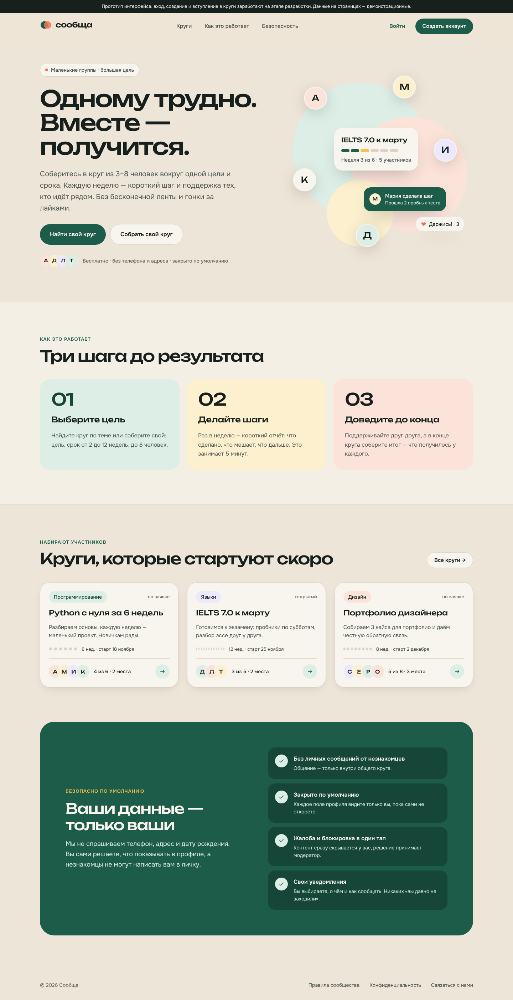 | 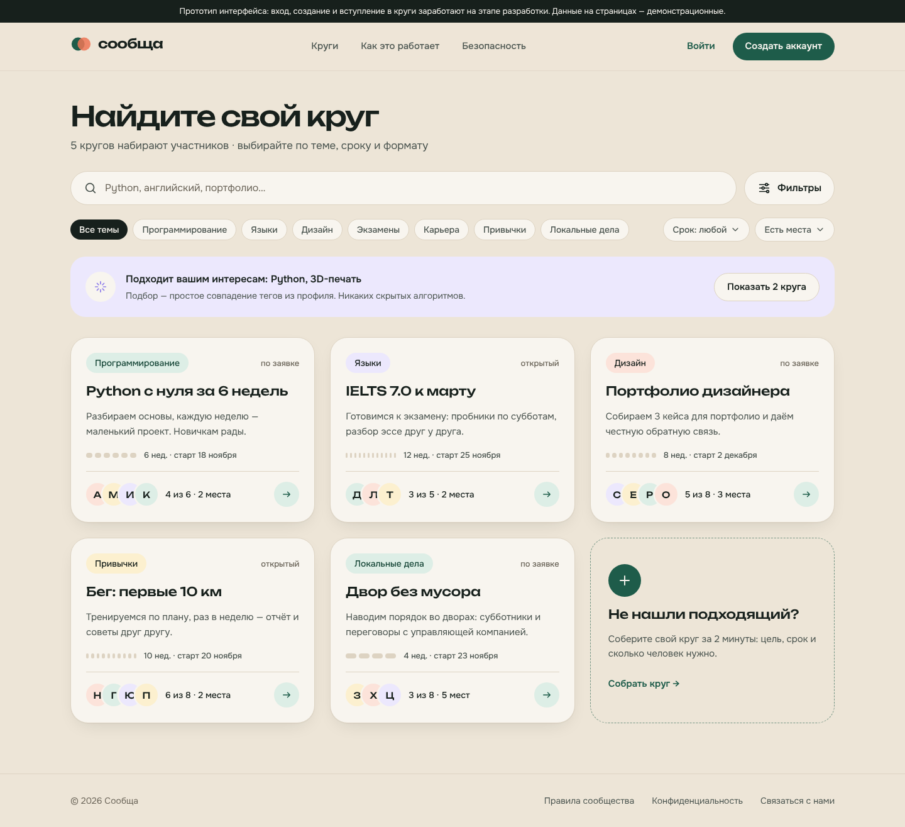 |

| Главная — телефон | Каталог — телефон |
|---|---|
|  | 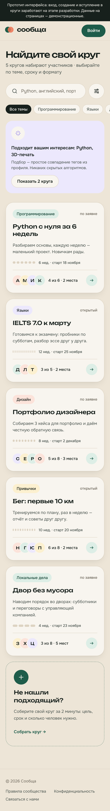 |

---

## v0.1 — исходные макеты (Figma)

Исходник: [Figma — «Сообща — дизайн MVP»](https://www.figma.com/design/F9eN9VmtDVKeEpWmqgCnp4).
Ниже — превью (уменьшенные снимки, сделаны во время работы). В Figma всё редактируемое:
цвета — переменные, кнопки, теги, аватары и карточка круга — компоненты.

## Визуальный стиль

- **Идея:** тёплый, спокойный, человечный. Бумажный фон вместо холодного белого,
  лесной зелёный — доверие и рост, коралловый — тепло поддержки.
- **Мотив — круг:** соприкасающиеся аватары и «недели-точки», которые заполняются по мере движения к цели.
- **Шрифты:** Unbounded (заголовки и цифры) + Onest (текст). Оба бесплатные, с полной кириллицей.
- **Формы:** скругления 16–28 px, мягкие тени, кнопки-«таблетки», зоны нажатия от 44 px.

| Токен | Цвет | Назначение |
|---|---|---|
| forest | `#1E5C4A` | основной цвет, кнопки |
| forest-700 | `#164637` | нажатие, тёмные плашки |
| mint | `#DDEEE6` | мягкий фон акцента |
| coral | `#EF7556` | тепло, поддержка |
| sun | `#F4C14E` | прогресс |
| lilac | `#8F7EEA` | темы, рекомендации |
| danger | `#C8442E` | ошибки, жалобы, выход |
| ink / ink-2 / ink-3 | `#17201C` / `#4A544F` / `#8A928D` | текст |
| paper / surface / line | `#F6F3EC` / `#FFFFFF` / `#E7E2D8` | фоны и линии |

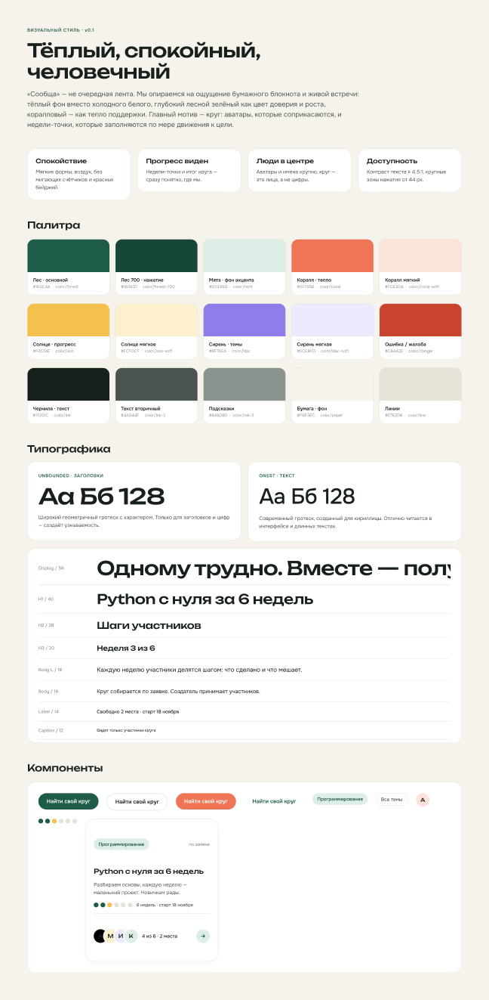

## Экраны

### Главная (компьютер)
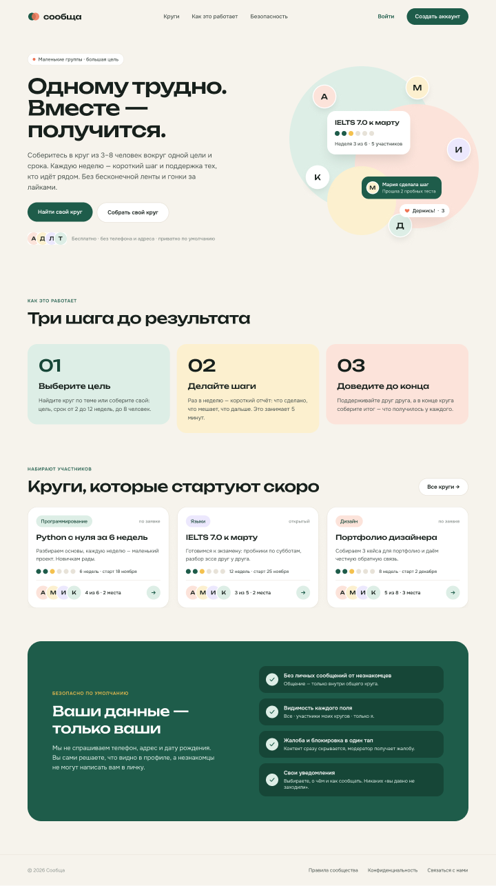

### Каталог кругов (компьютер)
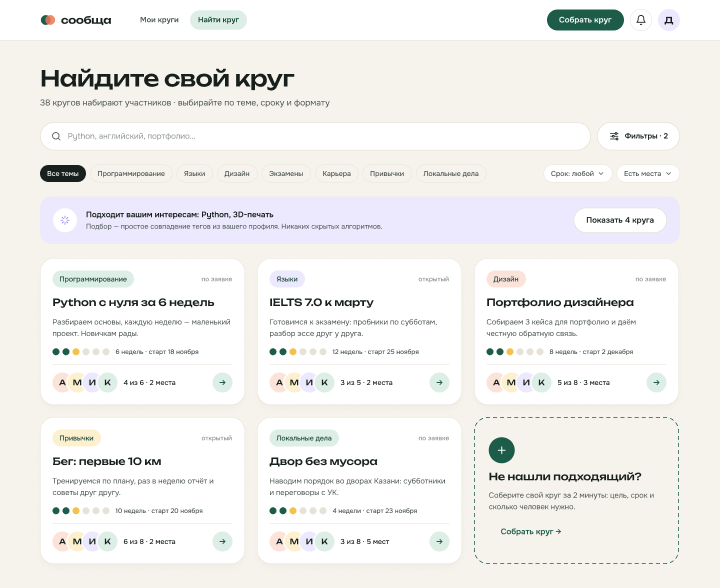

### Телефон
| Страница круга | Профиль участника | Мой профиль и видимость |
|---|---|---|
| 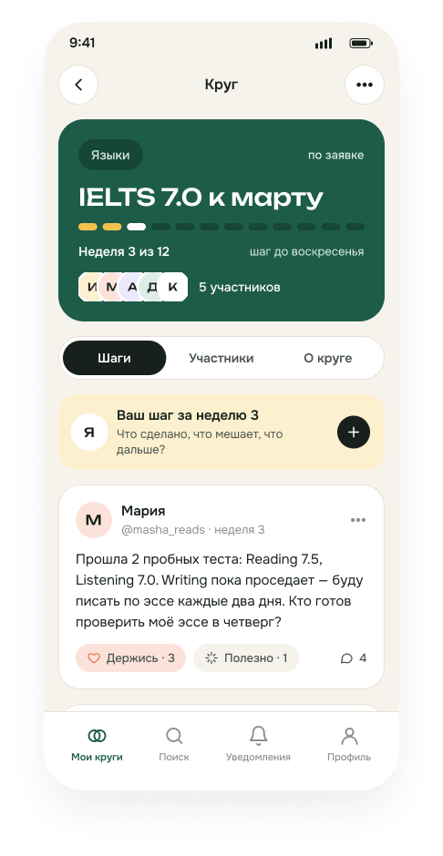 | 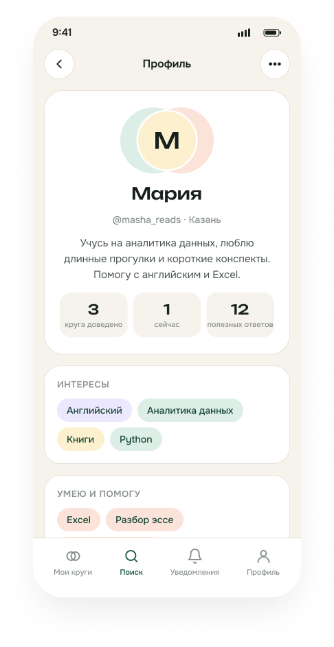 | 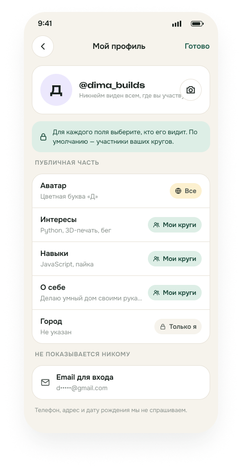 |

| Настройки уведомлений | Жалоба на публикацию | Меню круга и выход |
|---|---|---|
| 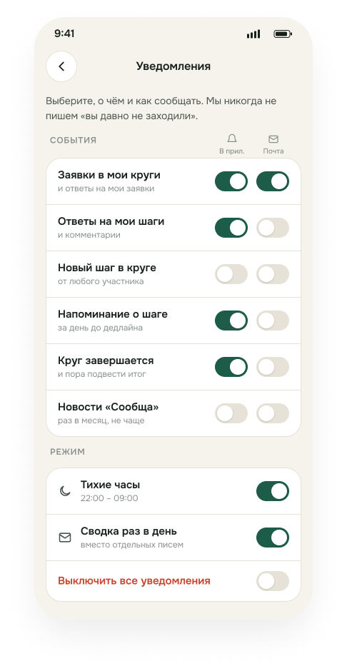 | 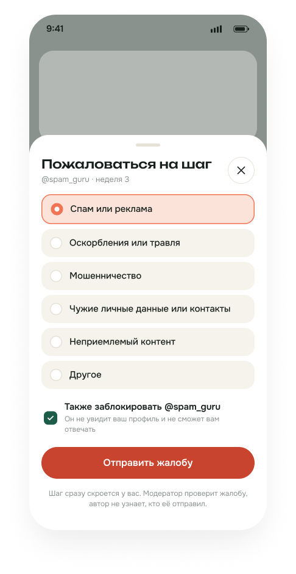 | 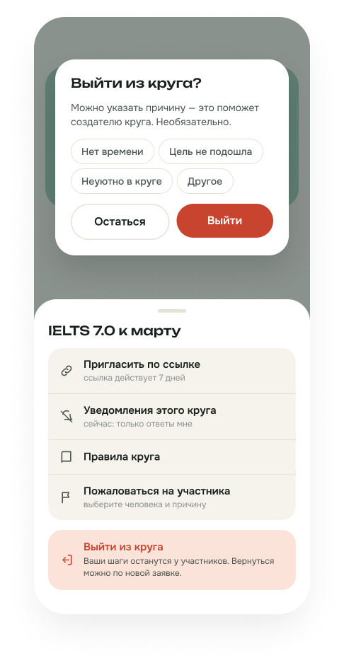 |

## Что ещё не нарисовано
Регистрация и вход, создание круга (пошаговая форма), список уведомлений, пустые состояния и ошибки,
планшетная раскладка. Их сделаем вместе с вёрсткой в коде, в том же стиле.
